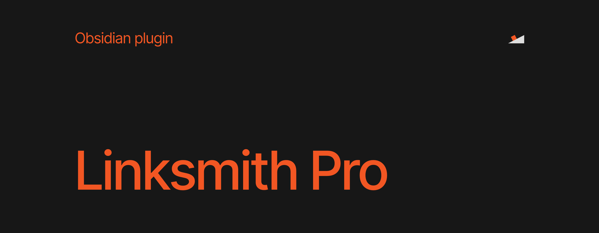
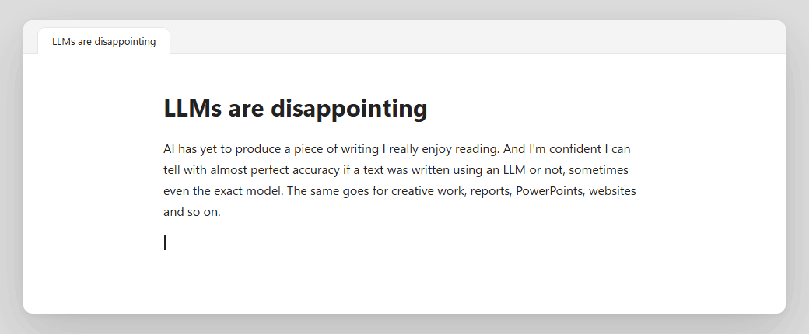
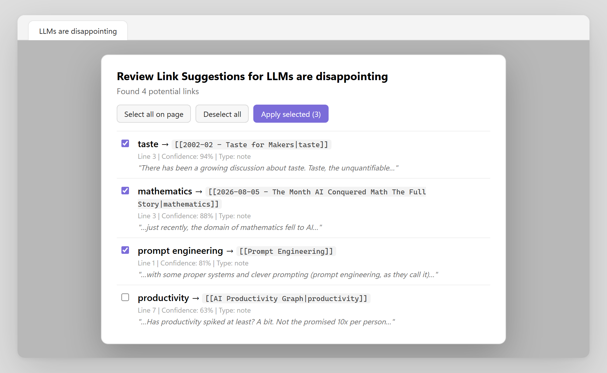

A vault gets its value from the links between notes, and most links never get written. You are in the middle of a sentence, you vaguely remember a note on exactly this, and stopping to look it up breaks the thought. So you keep writing, and the connection is lost.

Linksmith Pro suggests the link while you type. You don't need to open brackets or remember the exact title: type a word or two in plain text and it offers the notes and headings that match, ranked by how well they fit. Press Enter and your words stay as they are, but now they point somewhere. For the links you missed in the past, it can read a whole note or folder and show you everything it would link, and nothing changes until you have checked it.



## How it works

**While you write.** Suggestions appear after two letters, as you type `[[` or plain text of up to two words. They include note titles, aliases and headings. Notes that are often linked and notes you changed recently rank a little higher. When you pick one, the text you typed becomes the alias, so `taste` becomes `[[Taste for Makers|taste]]` and your sentence still reads the same.

**Afterwards.** The command **Retro-link current file** (or **current folder**) scans the text for titles, aliases and headings that are not linked yet. Each finding comes with its line, a confidence score and the sentence around it. You tick the ones you want and apply them in one step.



## Settings

Everything is in **Settings → Linksmith Pro**, in six groups: live suggestions, heading options, scoring weights, exclusions, retro-linking and performance. The defaults work well. The settings you will most likely touch are the exclusions (folders, files, tags, and regex patterns for titles and headings) and the minimum confidence for retro-linking.

You can also control a single note with its frontmatter:

```yaml
---
linksmith:
    - ignore-headings # index the note, but not its headings
linksmith_exclude_terms: # never link these terms in this note
    - 'term1'
    - 'term2'
---
```

Use `linksmith: ignore` to leave the note out of the index completely. `linksmith` takes a single value or a list, and `ignore` wins when both are there. Excluded terms are exact, case-insensitive titles, aliases or headings that retro-linking skips in that note.

## Commands

- **Toggle live suggestions**
- **Toggle heading suggestions**
- **Retro-link current file**
- **Retro-link current folder**
- **Rebuild index**

## Install

1. In Obsidian, open **Settings → Community plugins → Browse**.
2. Search for **Linksmith Pro**.
3. Select **Install**, then **Enable**.

To install it by hand, download `main.js`, `manifest.json` and `styles.css` from the [latest release](../../releases/latest) into `.obsidian/plugins/linksmith-pro/` in your vault, then reload Obsidian. Every release file is built by GitHub Actions and carries a build attestation, so you can check where it came from with `gh attestation verify main.js --repo Timandilu/obsidian-linksmith-pro`.

## Privacy

Everything happens inside Obsidian. The plugin makes no network requests and collects no data. To suggest links, it indexes the titles, aliases and headings that Obsidian already caches, minus your exclusions. Retro-linking reads only the notes you ask it to scan, and it writes only the links you approve.

## Build it yourself

```bash
npm install
npm run check
```

`npm run check` runs the formatter check, the linter, the tests and the production build.

## License

[MIT](LICENSE)

PS: The sentence in the demo is from my essay [LLMs are disappointing](https://readfriction.substack.com/p/llms-are-disappointing). I write about taste, agency and what AI does to both on [friction](https://readfriction.substack.com).
